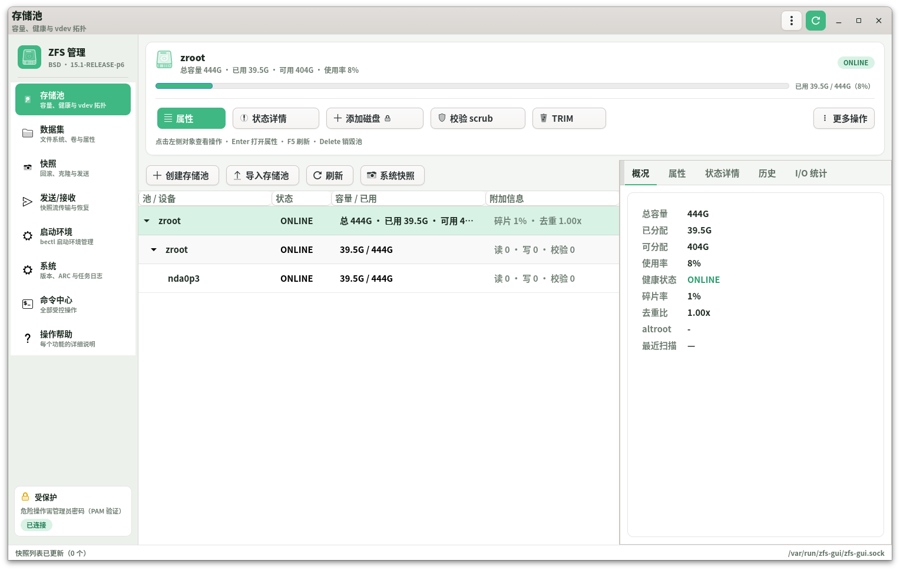
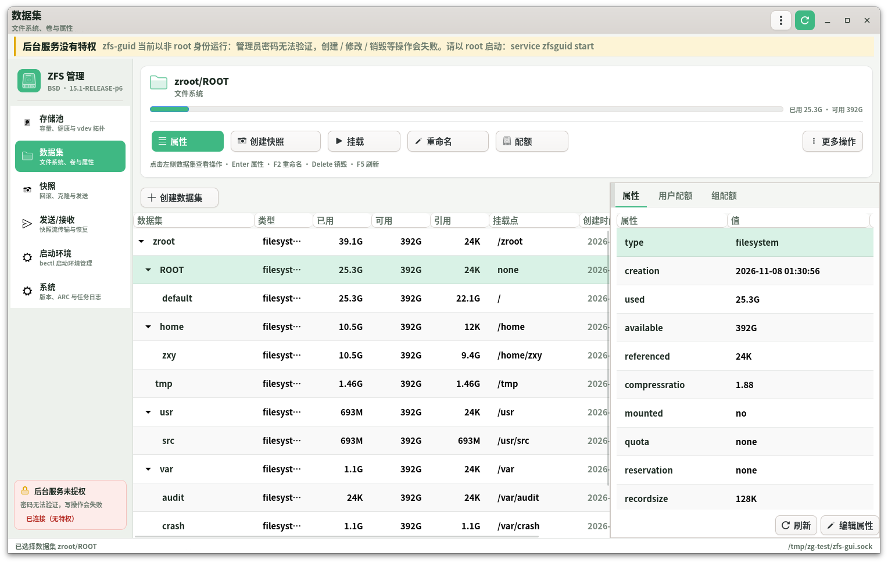
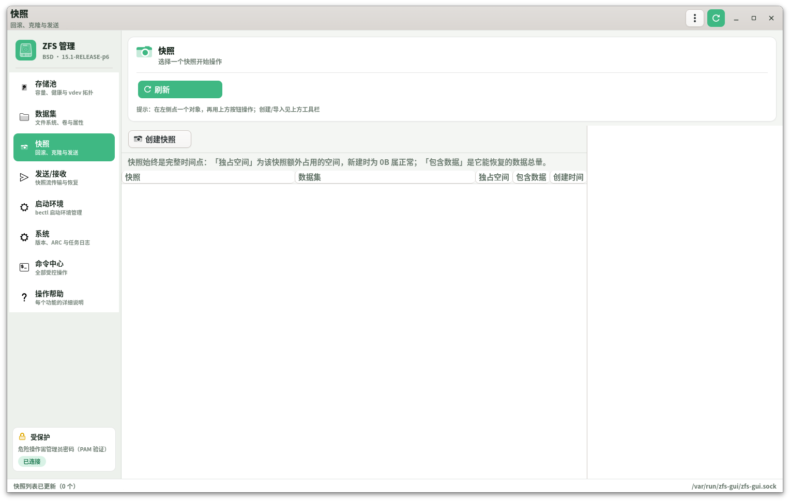
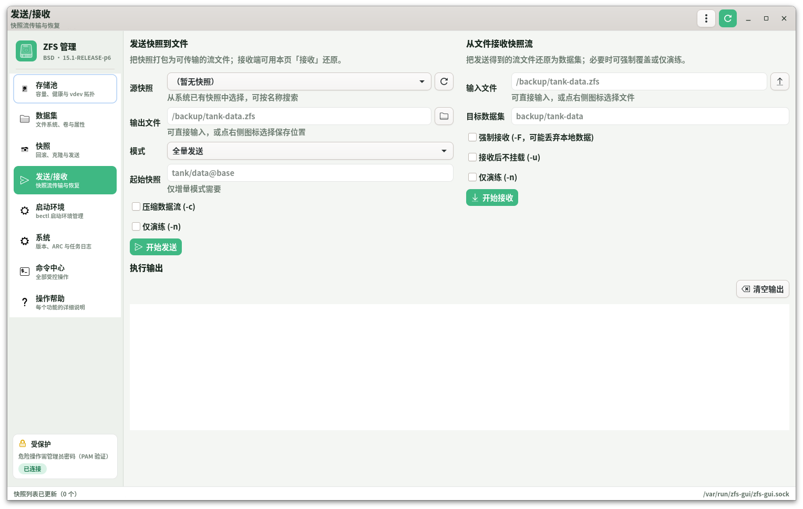
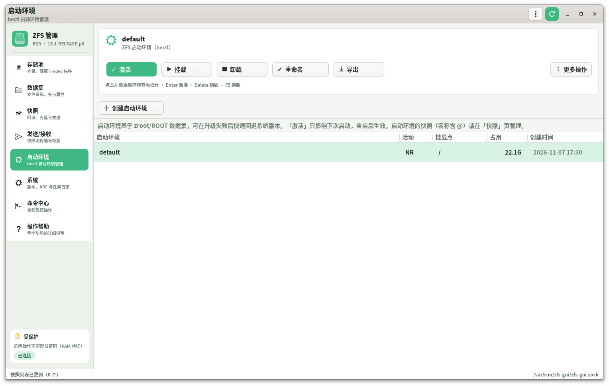
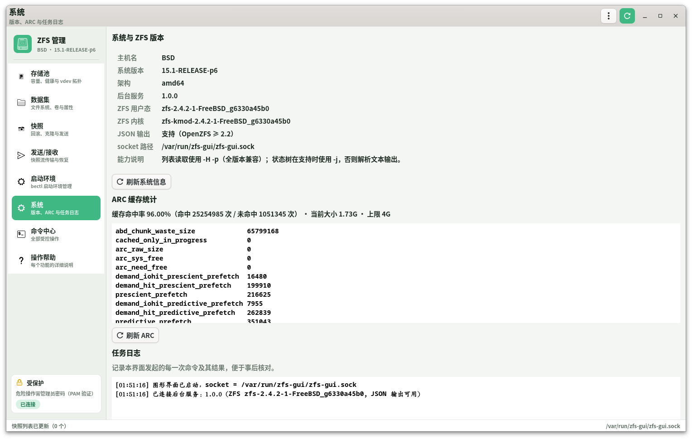
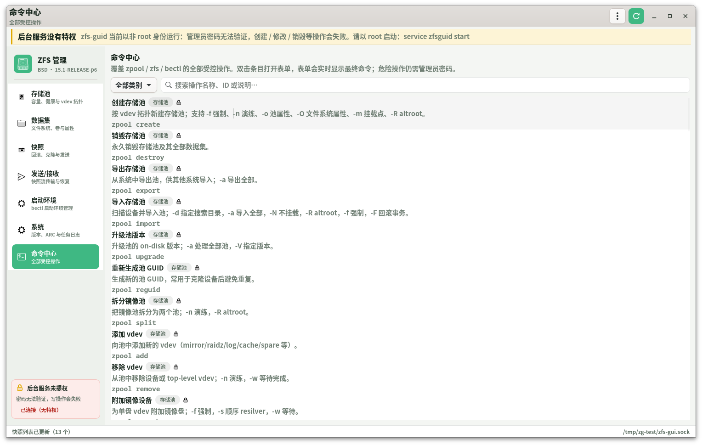
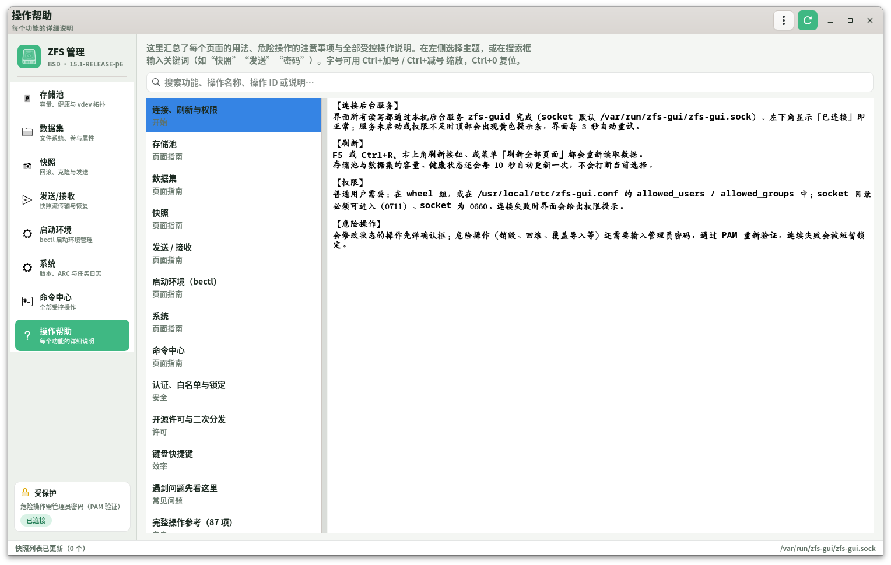

# ZFS-GUI for FreeBSD

[简体中文](README.zh-CN.md) | **English**

A graphical ZFS management suite for **FreeBSD + OpenZFS**, written in
**C17 + GTK4**. The frontend only draws the UI; every privileged operation is
performed by a root daemon constrained by a strict whitelist. This keeps the
`zpool`/`zfs` privileges out of the GUI process while remaining fully usable.

```
┌──────────────────────────┐        Unix socket         ┌────────────────────────┐
│  zfs-gui (GTK4, user)    │  ───────────────────────▶  │ zfs-guid (root, daemon)│
│  UI / parsing / forms    │   4-byte length + JSON     │ whitelist → execv()    │
└──────────────────────────┘                            └───────────┬────────────┘
                                                                    │ argv
                                                        ┌───────────▼────────────┐
                                                        │ /sbin/zpool  /sbin/zfs │
                                                        │ /sbin/bectl  /usr/sbin/jls │
                                                        └────────────────────────┘
```

## Screenshots

| Pools | Datasets |
| --- | --- |
|  |  |
| **Snapshots** | **Send / receive (live progress)** |
|  |  |
| **Boot environments (bectl)** | **System (version / ARC / task log)** |
|  |  |
| **Command center (87 controlled operations)** | **Help (every feature documented)** |
|  |  |

> Screenshots use the fixed Adwaita light theme with global bold text; the UI
> language is Chinese.

---

## 1. Features

| Area | Capabilities |
| --- | --- |
| Pools | create (single disk / stripe / mirror / RAID-Z1-3), destroy, import, export, upgrade, split, reguid |
| vdev management | add, remove, attach mirror, detach, replace, online/offline, clear errors, labelclear, reopen |
| Data integrity | scrub (start/stop/pause), TRIM, initialize, resilver, checkpoint, ddtprune, prefetch |
| Datasets | create filesystem / zvol, destroy, rename, clone, promote, mount/unmount, share (NFS/SMB) |
| Properties | read all native/user properties, edit, inherit, show source; human-readable sizes |
| Snapshots | create (recursive supported), rollback, destroy, clone, diff, hold/release, bookmark, redact |
| Send/receive | full, incremental (`-i`/`-I`), replication (`-R`), compressed, dry-run; file-based with live output |
| Encryption | load-key, unload-key, change-key |
| Delegation | `zfs allow` / `unallow` |
| Quotas | user / group / project space accounting and project quotas |
| FreeBSD specific | full `bectl` boot environment lifecycle, `zfs jail` / `unjail` |
| System | ZFS versions, ARC hit rate and statistics, pool history, I/O stats, event stream, task log, jail list |
| Advanced commands | menu → command center: CLI equivalents of the registry's operations (fallback entry point) |
| Security | dangerous operations require the **administrator password**; the daemon re-authenticates via PAM and rate-limits failures |

The interaction model is **"click an object → click a function"**: pick a pool,
vdev, disk, dataset, snapshot or boot environment in the left tree, and the top
panel immediately lists everything that object supports. Each action opens a
semantic wizard (pick disks, choose a layout, enter a quota, …); **no command
line parameters are ever typed**.

Keyboard: `Enter` primary action, `Delete` destroy, `F2` rename, `F5` refresh,
`Ctrl+Q` quit, `Alt+1..8` switch pages. The window has self-drawn
minimize/maximize/close buttons that work under any theme.

The layout is **sidebar navigation + content area**: six functional pages plus
the command center and the help page; success is reported with a toast in the
bottom-right corner, dangerous buttons are red with a lock icon and open an
administrator authorization dialog first.

### Theme and colors

* **Fixed light theme**: `GTK_THEME=Adwaita` is set at startup (overridable),
  so the look does not change with desktop dark/light preferences.
* **Green accent**: the palette lives at the top of `src/zg-ui.c`
  (`@zg_bg`, `@zg_surface`, `@zg_accent`, …); cards, buttons, tab underlines,
  progress bars and selected rows all use the same green.
* **Light hierarchy**: page background `#f4f6f3`, cards pure white, sidebar
  `#edf1ec`, 12% ink-green borders, row separators plus zebra stripes, and a
  soft green selection.
* **Typography**: global `Noto Sans CJK SC` with weight 600 and headings at
  800, which reads better than the default serif fonts and looks modern.

---

## 2. Design notes

### 2.1 Why a daemon + CLI instead of linking libzfs

* **Version independence**: only depends on the `zpool`/`zfs`/`bectl` command
  line, so anything from OpenZFS 0.8 to 2.4 works; no `libzfs.so` ABI binding and
  no `libzfs` headers required.
* **Privilege separation**: the GTK process runs as a normal user and never
  holds root; only the daemon is privileged.
* **Auditability**: every command is a readable argv, easy to review in logs and
  to reproduce by hand.

### 2.2 Security model (four layers)

1. **Socket permissions**: `root:wheel 0660`, directory `0711`, never `/tmp`.
2. **Peer verification**: `getpeereid(2)` obtains uid/gid and checks
   `allowed_users` / `allowed_groups`.
3. **Operation whitelist**: the request must be a registry operation ID; flags,
   option keys and positional values are validated one by one. **Positional
   values starting with `-` are rejected**, preventing argument injection.
   Execution always uses `execv()`, **never a shell**.
4. **Re-authentication for dangerous operations**: 27 operations (destroy,
   rollback, replace, import/export, change-key, delegation, …) require an
   administrator account and password. The daemon validates it through **PAM**
   and requires the account to be in the admin set (root / allowed_users /
   allowed_groups). The password lives only briefly on the daemon stack and is
   wiped with `explicit_bzero`; failures trigger a per-uid temporary lockout.

Any failed check returns a clear error and executes nothing.

#### Authorization levels

| Level | Count | Behavior |
| --- | --- | --- |
| Read-only | 20 | executed directly |
| Confirm | 39 | confirmation dialog showing the full command |
| Admin password | 27 | administrator authorization dialog, PAM verification required |

`auth_mode` can be `all` (password for every write) or `none` (disabled, not
recommended).

### 2.3 Compatibility strategy

* Lists, properties and snapshots use `zpool/zfs ... -H -p`: script mode with
  exact numbers, locale independent, supported by old OpenZFS releases too.
* `zpool status` has no `-H`, so the daemon prefers `-j` (OpenZFS ≥ 2.2) to parse
  the vdev tree and falls back to indentation-based parsing of the text output.
* Child processes run with `LC_ALL=C` for stable dates and numbers; the UI
  renders them in the local timezone.

---

## 3. Build

### 3.1 Dependencies (verified on FreeBSD 15.1)

```sh
pkg install meson ninja pkgconf gtk4
```

* FreeBSD 15.1-RELEASE / clang 19
* GTK ≥ 4.6 (developed with 4.20.4)
* GLib ≥ 2.66
* OpenZFS 2.4.2 (other 2.x / 1.x / 0.8 also work)

### 3.2 Compile

```sh
cd zfs-gui
meson setup build
ninja -C build
```

Backend only (e.g. a headless server):

```sh
meson setup build -Dgui=disabled
```

### 3.3 One-click install (recommended)

```sh
su -c 'sh scripts/install.sh'
```

The script checks dependencies → builds → installs → registers the desktop icon
→ enables and starts the daemon → waits for the socket.

Options:

```sh
sh scripts/install.sh --no-service        # install only, do not start the service
sh scripts/install.sh --destdir /tmp/x    # stage without root (for packaging)
su -c 'sh scripts/install.sh --uninstall' # uninstall (keeps config; --purge removes it)
```

After installation open **Application menu → System → ZFS Management Tool**
(icon `zfs-gui`), or run `zfs-gui` from a terminal.

### 3.4 Self-test

```sh
sh scripts/selftest.sh          # protocol self-test (21 checks)
sh scripts/selftest.sh --gui    # plus a GUI startup smoke test
```

The self-test starts an isolated daemon in a temporary directory and does not
touch the running service.

### 3.5 Manual install

```sh
ninja -C build install
```

Installed files:

| Path | Description |
| --- | --- |
| `/usr/local/bin/zfs-gui` | GTK4 frontend |
| `/usr/local/sbin/zfs-guid` | root daemon |
| `/usr/local/etc/zfs-gui.conf` | daemon configuration |
| `/usr/local/etc/rc.d/zfsguid` | rc.d script |
| `/usr/local/share/applications/org.freebsd.zfsgui.desktop` | desktop entry |
| `/usr/local/share/man/man8/zfs-guid.8` | manual page |
| `/etc/pam.d/zfs-gui` | PAM service for re-authentication |

### 3.6 Building a FreeBSD `.pkg`

```sh
sh packaging/build-pkg.sh            # build + package
sh packaging/build-pkg.sh --no-build # package existing build output
```

Output: `dist/zfs-gui-1.0.0.pkg`. The script stages the install with `DESTDIR`,
generates `+MANIFEST` (version, ABI, gtk4/glib dependencies) and creates the
package.

Install / remove:

```sh
sudo pkg add -f dist/zfs-gui-1.0.0.pkg
sudo pkg delete zfs-gui
```

The package contains the frontend, daemon, rc.d script, configuration, PAM file,
desktop entry, icon, man page, LICENSE and open-source notes. Its ABI matches the
build host (e.g. `FreeBSD:15:amd64`); rebuild on other major FreeBSD versions.

---

## 4. First-time configuration

### 4.1 Start the daemon

```sh
sysrc zfsguid_enable=YES
service zfsguid start
```

Check:

```sh
service zfsguid status
ls -l /var/run/zfs-gui/zfs-gui.sock    # srw-rw---- root wheel
```

### 4.2 Authorizing users

`/usr/local/etc/zfs-gui.conf`:

```ini
allowed_users  = root
allowed_groups = wheel          # members of wheel may operate
socket_path    = /var/run/zfs-gui/zfs-gui.sock
socket_group   = wheel          # keep in sync with allowed_groups
socket_mode    = 0660
io_timeout     = 600            # normal operation timeout; long tasks are exempt

auth_mode          = dangerous  # dangerous / all / none
auth_max_attempts  = 3
auth_lockout       = 300        # seconds
```

Restart after changes: `service zfsguid restart`. Add a user to `wheel`:

```sh
pw groupmod wheel -m youruser
```

> ⚠️ Authorizing a user means they can perform **every** ZFS operation through
> the GUI, including destroying pools. Only authorize trusted administrators.

### 4.3 Launch the GUI

```sh
zfs-gui
```

or use "ZFS Management Tool" from the application menu.

---

## 5. Usage

### 5.1 Interaction model

1. **Pick an object** in the left tree: pool, vdev, disk, dataset, snapshot or
   boot environment. The top panel shows its name, capacity and health.
2. **Pick a function**: the buttons are everything that object supports, e.g. a
   selected disk shows "replace / offline / online / detach / clear errors /
   status".
3. **Fill the wizard**: semantic dialogs (pick disks, mirror/RAID-Z, quota,
   wait or not) hide all command line parameters.
4. **Confirm**: dangerous actions (red button + lock) require the administrator
   password.

The hint line under the panel lists the available keyboard shortcuts.

### 5.2 Authorization and re-authentication

Dangerous actions (red buttons, or ⚠ in the command center) open a
**"Administrator authorization required"** window that shows the full command
and asks for an administrator account and password. The password field can be
shown/hidden; failures are reported in the dialog and can be retried, and too
many failures lock the uid temporarily.

The security card at the bottom of the sidebar shows the current policy
(`dangerous` / `all` / `none`) and connection state.

### 5.3 Pools

The left side is a "pool → vdev" tree fed by `zpool status`. Selecting a pool
shows five tabs: **Overview / Properties / Status / History / I/O stats**.

The toolbar also has a one-click **"System snapshot"** button:
`zfs snapshot -r <pool>@system-YYYYMMDD-HHMMSS`, recursively covering every
dataset in the pool, with a toast and an automatic refresh when done.

Common actions are on the object panel: export, scrub, TRIM, clear errors,
destroy; the rest (attach/detach/replace/online/offline/split/upgrade/checkpoint…)
are under **"All operations…"**, pre-filled with the selected pool.

Right-clicking a tree node offers quick scrub, TRIM, export and destroy.

### 5.4 Datasets

The hierarchy shows all datasets and volumes; the **Properties** tab lists every
property with its source (`default` / `local` / `received` / `inherited from …`).
Select a property and click "Edit property" to change it or restore inheritance.

The toolbar provides create dataset/volume, rename, mount, unmount, snapshot,
encryption/keys, delegation and destroy. The "User quota" and "Group quota" tabs
show `zfs userspace` / `groupspace` results.

### 5.5 Snapshots

Lists all snapshots (name, dataset, used, referenced, creation time); the right
side shows hold tags. The context menu offers rollback, send, clone, diff,
hold/release, bookmark and destroy.

### 5.6 Send / receive

The **source snapshot** dropdown on the Send/Receive page auto-discovers existing
snapshots (searchable, with a refresh button); both **output file** and **input
file** have a picker button that opens the system file chooser, including mounted
external drives.

The **"Send"** button on the snapshot page opens a live backup window showing
the target file, bytes written, elapsed time and a scrolling log; it refreshes
automatically and reports success when done.

`zfs send` / `zfs receive` are performed through files:

* send: source snapshot + output file + mode (full / `-i` / `-R` / `-I`) +
  compress / dry-run;
* receive: input file + target dataset + force `-F` / no mount `-u` / dry-run `-n`.

Output is streamed to the text box at the bottom; `-F` also requires a
destructive-action confirmation.

### 5.7 Boot environments (FreeBSD)

Lists `bectl list` (name, active state, mountpoint, used, creation time) and
supports create, activate, rename, mount, unmount, export, import and destroy.

### 5.8 Command center

Day-to-day work uses the object panels. For less common functions, open
**Command center** in the sidebar: search the 87 controlled operations by
category or keyword, double-click an entry to open its form; every parameter has
type hints and live validation, and the final command is previewed in real time.

### 5.9 Help page

The **Help** page in the sidebar documents every page in detail: connection and
permissions, pools, datasets, snapshots, send/receive, boot environments, system,
command center, authorization, shortcuts and FAQ. It also auto-generates the
**full operation reference** (name, ID, description and authorization level per
category). The search box filters topics; `Alt+8` jumps to the page. Text size
can be zoomed with `Ctrl+=` / `Ctrl+-` / `Ctrl+0`.

### 5.10 System

ZFS userland/kernel versions, JSON capability, socket path, ARC hit rate and all
kstat statistics, plus the task log of every command issued by the UI.

---

## 6. Troubleshooting

| Symptom | Fix |
| --- | --- |
| "Backend not connected" banner | `service zfsguid onestart`; make sure `/usr/local/etc/zfs-gui.conf` exists |
| still disconnected after boot | check `sysrc zfsguid_enable=YES`; the rc.d script now starts after `cleanvar` and `ldconfig` (older versions lost their socket when `/var/run` was cleaned, or failed to find libraries in `/usr/local/lib`); inspect `service zfsguid status` |
| "Access denied: user xxx is not allowed" | add the user to the group in `allowed_groups`, or to `allowed_users` |
| every operation returns permission denied | the daemon is not running as root, or `zfs`/`zpool` lack privileges |
| properties/history pages are empty | `zpool history` and `zfs userspace` need privileges when the daemon is not root |
| UI stuck on "running…" | long tasks (send/receive/scrub -w) continue in the background; check System → task log |
| "Authentication failed: wrong password" | use root or a member of wheel; ensure `/etc/pam.d/zfs-gui` exists |
| "Too many failed attempts" | wait `auth_lockout` seconds, or remove `/var/run/zfs-gui/.authfail-<uid>` |
| "System PAM unavailable" | verify `/etc/pam.d/zfs-gui` (or `system`) exists and is readable |
| daemon logs | run it in the foreground: `zfs-guid -f -c /usr/local/etc/zfs-gui.conf` |

For debugging, point the frontend at another socket:

```sh
zfs-guid -f -c ./test.conf        # another terminal
ZFS_GUI_SOCKET=/tmp/zg-test/zfs-gui.sock zfs-gui
```

Non-root daemon for UI development only (privileged actions will fail):

```sh
ZFS_GUI_ALLOW_NONROOT=1 zfs-guid -f -c ./test.conf
```

---

## 7. Code structure

```
zfs-gui/
├── meson.build              # common lib + daemon + frontend
├── common/                  # shared between frontend and daemon
│   ├── zg-protocol.h        # framing constants
│   ├── zg-json.[ch]         # minimal JSON parser/writer
│   ├── zg-opdef.[ch]        # operation registry (whitelist + form metadata)
│   ├── zg-argv.[ch]         # request parsing, validation, argv building
│   ├── zg-io.[ch]           # 4-byte length + payload framing
│   └── zg-util.[ch]         # formatting and name validation
├── daemon/
│   ├── zfs-guid.c           # entry point: options, daemonize, pidfile
│   ├── zg-server.c          # accept + fork per connection, getpeereid auth
│   ├── zg-policy.c          # configuration and user/group authorization
│   ├── zg-exec.c            # fork/execv, output capture, timeout, process group kill
│   ├── zg-ops.c             # generic execution + system.info / system.arcstats
│   ├── zg-auth.c            # PAM re-authentication and failure rate limiting
│   └── zg-log.c             # stderr in foreground / syslog in background
├── src/
│   ├── main.c               # frontend entry point
│   ├── zg-app.c             # app context, connection probing, refresh scheduling, task log
│   ├── zg-client.c          # async IPC client and argument builder
│   ├── zg-model.c           # parsers and data models for all ZFS output
│   ├── zg-ui.c              # shared widgets, CSS, status coloring
│   ├── zg-window.c          # main window and pages
│   ├── zg-actions.c         # object action panel (click object → click function)
│   ├── zg-dialogs.c         # authorization, confirmation, generic forms, wizards
│   ├── zg-dialogs-objects.c # choice / input / add disk / replace disk
│   ├── zg-dialogs-import.c  # import-pool browser
│   ├── zg-dialogs-secure.c  # encryption, delegation, quotas, sharing
│   └── zg-page-*.c          # the eight pages
├── data/                    # rc.d, desktop, default config, man, pam.d
└── docs/                    # architecture and feature matrix (Chinese)
```

See [docs/ARCHITECTURE.md](docs/ARCHITECTURE.md) for the design and
[docs/FEATURES.md](docs/FEATURES.md) for the command coverage matrix
(both currently in Chinese).

---

## 8. Adding a ZFS operation

Add one entry to the registry in `common/zg-opdef.c`:

```c
{
  .id = "zfs.myop",
  .tool = "zfs",
  .subcommand = "myop",
  .title = "My new operation",
  .description = "One sentence, shown in the command center.",
  .category = ZG_CAT_DATASET,
  .auth = ZG_AUTH_CONFIRM,        /* use ZG_AUTH_PASSWORD for dangerous ops */
  .destructive = FALSE,
  .spec = {
    .flags = F ("-v"),
    .options = (const char *const []) { "o", NULL },
    .min_positional = 1,
    .max_positional = 1,
    .kinds = { ZG_VALUE_DATASET },
  },
},
```

No frontend changes are required: the command center picks it up automatically,
including the form, validation and command preview. For a dedicated UI, call
`zg_dialogs_run_op()` from the corresponding page.

---

## 9. Coding standard

* **Language**: C17 (`-std=c17`), no GNU extensions.
* **Formatting**: clang-format (see [`.clang-format`](.clang-format)) — 4 spaces,
  no tabs, Allman braces. One-shot: `sh scripts/format.sh`.
* **Static checks**: `-Wpedantic` plus several `-Werror=` flags;
  `sh scripts/check-strict-c.sh`.
* **Audit**: `python3 scripts/audit-c.py` (parameter count, naming, magic
  numbers, dangerous string functions).
* **Naming**: lower_snake_case for variables/functions, UPPER_CASE for
  constants/macros, PascalCase for types.
* **Functions**: short, single purpose, **at most 3 parameters**; use parameter
  structs (`ZgPanelSpec`, `ZgChoiceSpec`, `ZgInputSpec`) beyond that. GTK signal
  callbacks are exempt because their signature is fixed.
* **Memory and errors**: check syscall return values; use GLib allocation
  (`g_new`, `g_strdup`, …); no bare `malloc`; wipe secrets with
  `explicit_bzero`; `strcpy`/`strcat`/`sprintf`/`gets` are forbidden.
* **Magic numbers**: security-relevant constants (modes, timeouts, buffer sizes,
  failure thresholds) must be named constants such as
  `ZG_AUTH_SECRET_FILE_MODE`.

---

## 10. License

**BSD 2-Clause**. You may use, modify, distribute, use commercially and ship
closed-source derivatives; redistributions only need to keep the copyright
notice, license text and disclaimer. See [LICENSE](LICENSE) and
[OPEN-SOURCE.md](OPEN-SOURCE.md) (Chinese) for details.

> The software is provided "as is", without warranty. Be careful with destroy,
> rollback and format operations, and always keep backups.
