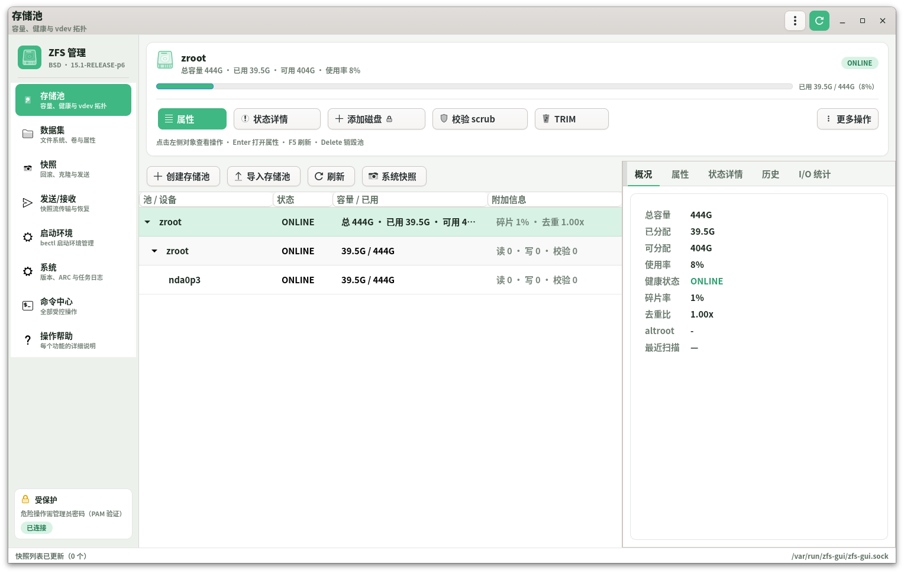
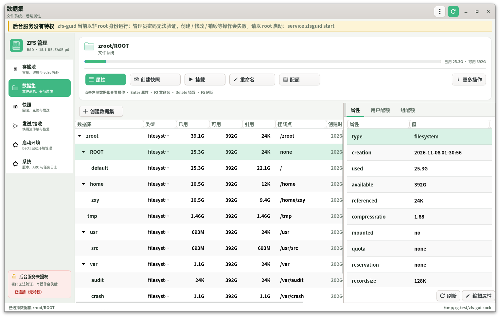
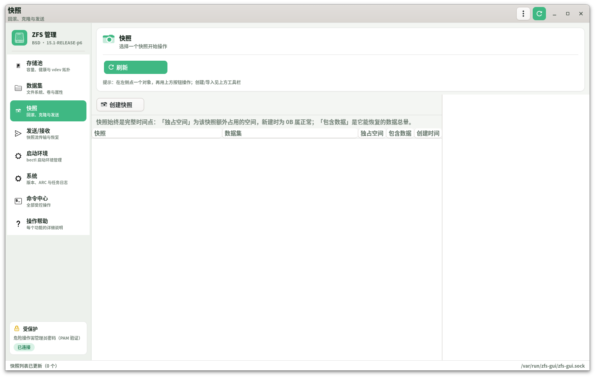
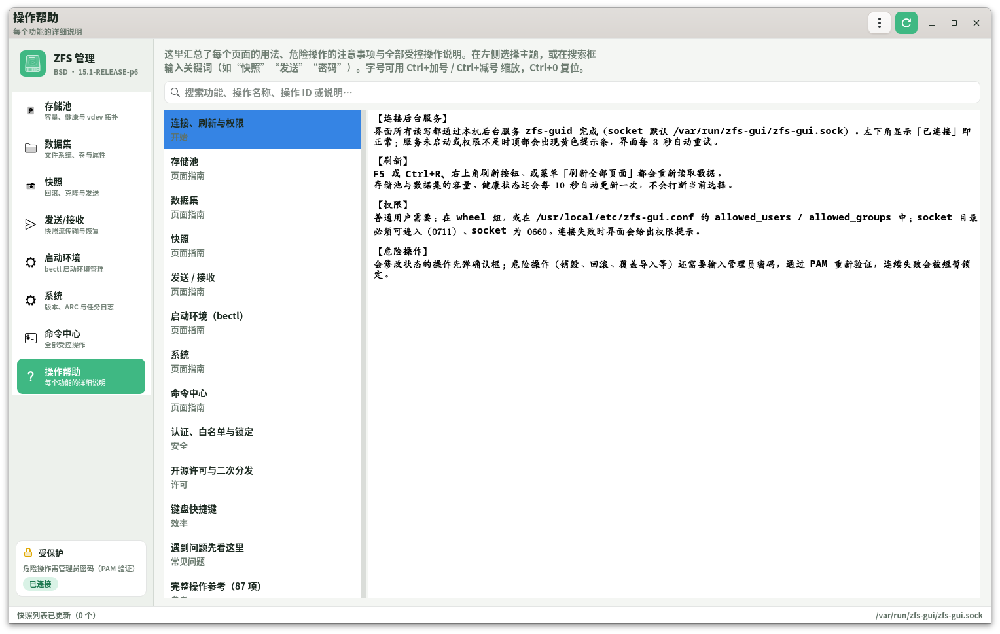

# ZFS-GUI for FreeBSD

**A GTK4 ZFS management suite for FreeBSD + OpenZFS.**
**面向 FreeBSD + OpenZFS 的 GTK4 图形化 ZFS 管理套件。**

[简体中文](README.zh-CN.md) | [English](README.en.md)

The GUI runs as a normal user; every privileged operation goes through a root
daemon guarded by a strict whitelist, argument validation and PAM
re-authentication for dangerous actions.

图形界面以普通用户运行，所有特权操作交给受白名单、参数校验和 PAM 二次认证
保护的 root 守护进程执行，兼顾易用与安全。

## Highlights / 主要特性

* **Object-driven UI** — pick a pool, vdev, disk, dataset, snapshot or boot
  environment, then click the action; no command parameters are typed.
  点对象 → 点功能，全程语义化向导，不需要记命令参数。
* **Full ZFS coverage** — pools/vdevs, datasets, properties, quotas, snapshots,
  send/receive, encryption, delegation, boot environments, ARC and history.
  覆盖存储池、数据集、属性、配额、快照、发送/接收、加密、委派、启动环境等。
* **Safe by design** — whitelisted operations, `execv` only, admin password for
  27 dangerous operations, per-uid lockout.
  白名单 + 仅 `execv`，27 个危险操作需管理员密码，失败临时锁定。
* **Bilingual documentation** — Chinese and English guides; built-in help page
  and searchable operation reference.
  中英文文档；界面内置操作帮助与全部操作参考。

## Screenshots

| Pools 存储池 | Datasets 数据集 |
| --- | --- |
|  |  |
| **Snapshots 快照** | **Help 操作帮助** |
|  |  |

## Quick start

```sh
# FreeBSD package
sudo pkg add -f dist/zfs-gui-1.0.0.pkg

# or build from source
sh scripts/install.sh
```

See the full guides: **[中文](README.zh-CN.md)** · **[English](README.en.md)**

## License

BSD 2-Clause — see [LICENSE](LICENSE) and [OPEN-SOURCE.md](OPEN-SOURCE.md).
