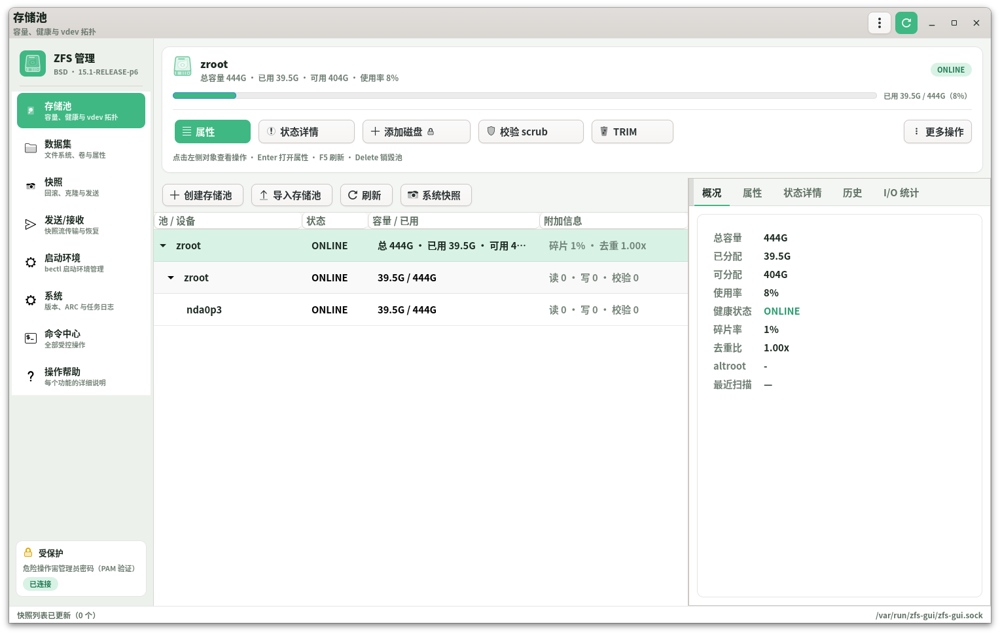
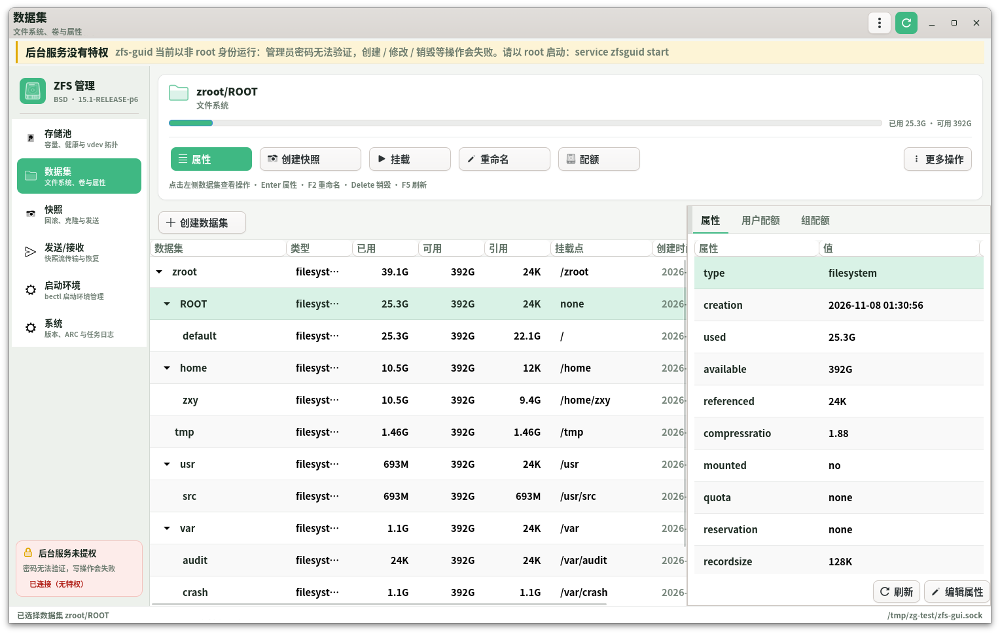
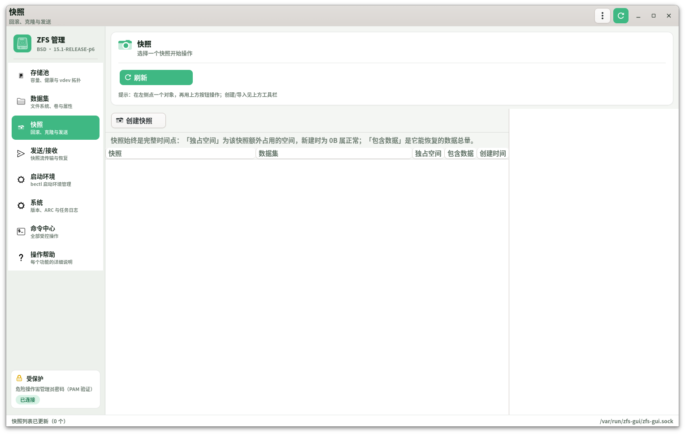
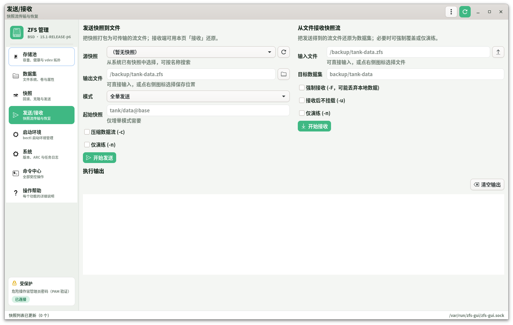
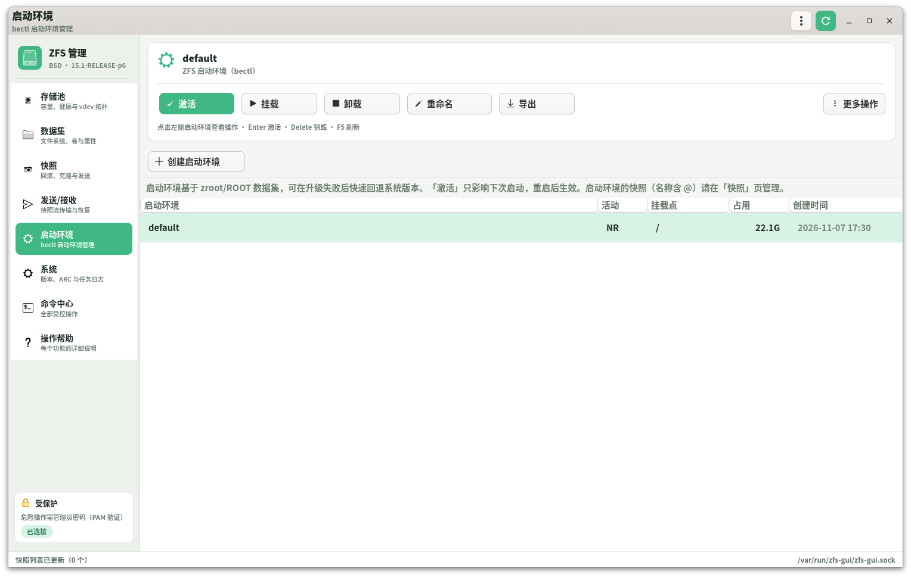
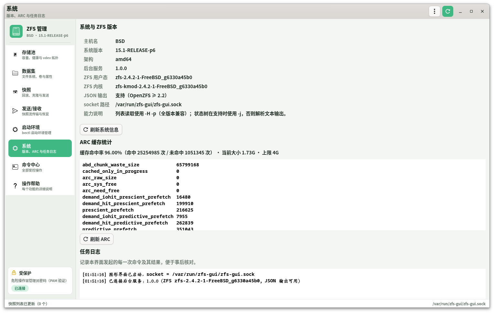
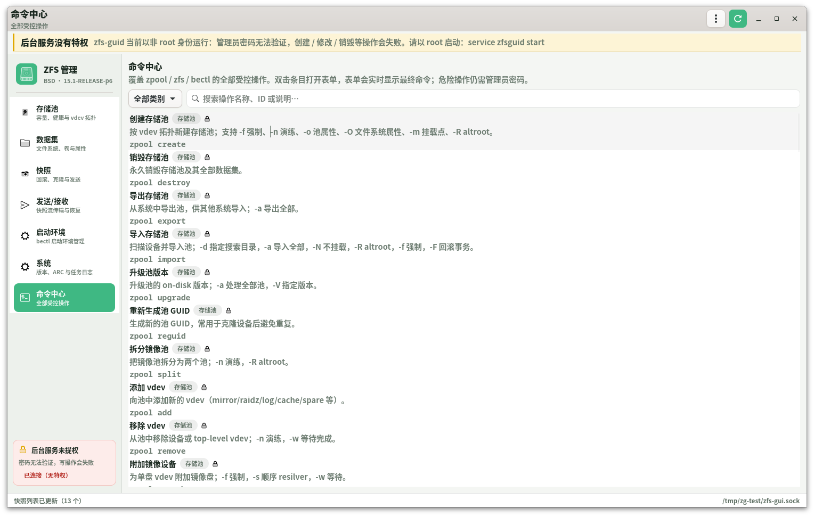
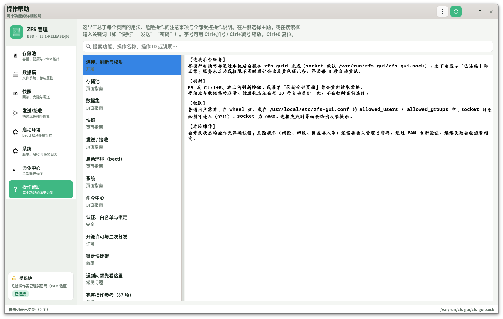

[简体中文](README.zh-CN.md) | [English](README.en.md)

# ZFS 管理工具（ZFS-GUI for FreeBSD）

面向 **FreeBSD + OpenZFS** 的图形化 ZFS 管理套件，使用 **C17 + GTK4** 编写。
前端只负责界面，所有特权操作交给一个受严格白名单约束的 root 守护进程执行，
既保证可用性，也避免把 `zpool`/`zfs` 的全部权限暴露给图形界面进程。

```
┌──────────────────────────┐        Unix socket         ┌────────────────────────┐
│  zfs-gui（GTK4，普通用户）│  ───────────────────────▶  │ zfs-guid（root，守护） │
│  界面 / 解析 / 表单        │   4 字节长度 + JSON 帧      │ 白名单校验 → execv()   │
└──────────────────────────┘                            └───────────┬────────────┘
                                                                    │ argv
                                                        ┌───────────▼────────────┐
                                                        │ /sbin/zpool  /sbin/zfs │
                                                        │ /sbin/bectl  /usr/sbin/jls │
                                                        └────────────────────────┘
```

## 界面预览

| 存储池 | 数据集 |
| --- | --- |
|  |  |
| **快照** | **发送 / 接收（实时备份进度）** |
|  |  |
| **启动环境（bectl）** | **系统（版本 / ARC / 任务日志）** |
|  |  |
| **命令中心（87 项受控操作）** | **操作帮助（全部功能说明）** |
|  |  |

> 截图使用 Adwaita 浅色主题、全局粗体；界面文字为中文。

---

## 1. 特性

| 领域 | 能力 |
| --- | --- |
| 存储池 | 创建（单盘 / 条带 / 镜像 / RAID-Z1-3）、销毁、导入、导出、升级、拆分、reguid |
| vdev 管理 | 添加、移除、附加镜像、拆除、替换、上线/下线、清除错误、labelclear、reopen |
| 数据校验 | scrub（启动/停止/暂停）、TRIM、initialize、resilver、checkpoint、ddtprune、prefetch |
| 数据集 | 创建文件系统 / zvol、销毁、重命名、克隆、promote、挂载/卸载、共享（NFS/SMB） |
| 属性 | 读取全部原生/用户属性，编辑、继承、来源显示；容量自动转人类可读 |
| 快照 | 创建（含递归）、回滚、删除、克隆、差异比较、hold/release、书签、脱敏 |
| 发送/接收 | 全量、增量（`-i`/`-I`）、复制（`-R`）、压缩、演练；文件为中介，输出实时回显 |
| 加密 | load-key、unload-key、change-key |
| 委派 | `zfs allow` / `unallow` 权限委派 |
| 配额 | 用户 / 组 / 项目空间统计与项目配额管理 |
| FreeBSD 特有 | 启动环境（`bectl`）全生命周期、`zfs jail` / `unjail` |
| 系统 | ZFS 版本、ARC 命中率与统计、池历史、I/O 统计、事件流、任务日志、jail 列表 |
| 高级命令 | 菜单 → 高级命令：注册表中 86 个操作的命令行等价物（备用入口） |
| 安全 | 危险操作执行前必须输入**管理员密码**，守护进程用 PAM 重新验证并限制失败次数 |

交互模型是**「点对象 → 点功能」**：在左侧树里点一个存储池、vdev、磁盘、数据集、
快照或启动环境，顶部操作面板立刻列出这个对象能做的所有事；每个动作都对应一个
语义化向导（勾选磁盘、选择布局、填写配额……），**不需要填写任何命令参数**。
键盘同样可用：Enter 执行主操作、Delete 销毁、F2 重命名、F5 刷新、Ctrl+Q 退出、Alt+1..7 切换功能页。
窗口右上角提供最小化 / 最大化 / 关闭按钮（自绘，任何主题下都可用），
菜单里也有「退出」。

界面采用**侧边导航 + 内容区**布局：左侧固定导航栏展示 6 个功能域与实时安全状态，
成功操作以右下角 Toast 提示，危险操作按钮为红色并带锁标记，执行前弹出管理员授权窗口。

六个功能域：**存储池、数据集、快照、发送/接收、启动环境、系统**；
`zpool`/`zfs` 命令行等价物收进 **菜单 → 高级命令**，只作为备用入口。

### 配色与主题

* **固定浅色主题**：应用启动时设置 `GTK_THEME=Adwaita`（可用环境变量覆盖），
  不再跟随桌面深浅色变化，保证任何环境下观感一致。
* **绿色强调色**：调色板集中定义在 `src/zg-ui.c` 顶部（`@zg_bg`、`@zg_surface`、
  `@zg_accent` 等），卡片、按钮、页签下划线、进度条、表格选中行统一使用绿色。
* **浅色层次**：页面背景 `#f4f6f3`、卡片纯白、侧栏 `#edf1ec`、边框 12% 墨绿，
  表格行间横线 + 斑马纹，选中行为淡绿色。
* **字体**：全局使用 `Noto Sans CJK SC`（思源黑体）无衬线字体、600 字重，
  标题 800 字重；取代系统默认的衬线字体，中文小字更清晰、观感更现代。


---

## 2. 设计要点

### 2.1 为什么用「守护进程 + CLI」而不是直接链接 libzfs

* **跨版本通用**：只依赖 `zpool`/`zfs`/`bectl` 命令行，从 OpenZFS 0.8 到 2.4 均可工作；
  不绑定 `libzfs.so` 的 ABI，也不要求系统安装 `libzfs` 头文件。
* **权限分离**：GTK 进程以普通用户运行，不持有 root；只有守护进程需要特权。
* **可审计**：每条命令都是一条可读 argv，日志里一目了然，也便于人工复现。

### 2.2 安全模型（四道防线）

1. **socket 文件权限**：默认 `root:wheel 0660`，目录 `0700`（不再使用 `/tmp`）。
2. **对端身份校验**：`getpeereid(2)` 取到 uid/gid，按 `allowed_users` / `allowed_groups` 判定。
3. **操作白名单**：请求必须是注册表中的操作 ID；开关、选项键、位置参数逐项校验；
   **位置参数以 `-` 开头一律拒绝**，杜绝参数注入。最终只调用 `execv()`，**从不经过 shell**。
4. **危险操作二次认证**：销毁、回滚、替换设备、导入导出、改密钥、委派权限等
   27 个操作执行前必须提交「管理员账号 + 密码」，守护进程用 **PAM** 重新验证，
   并要求该账号属于管理员集合（root / allowed_users / allowed_groups）。
   密码只在守护进程栈上短暂存在，用完 `explicit_bzero` 清零，不写日志、不落盘；
   连续失败会按 uid 触发临时锁定。

任何一步失败都会得到明确的中文错误信息，且不会执行任何命令。

#### 操作危险等级

| 等级 | 数量 | 行为 |
| --- | --- | --- |
| 只读 | 20 | 直接执行，不做确认 |
| 需确认 | 39 | 弹出确认框并显示完整命令 |
| 需管理员密码 | 27 | 弹出管理员授权窗口，PAM 验证通过后才执行 |

`auth_mode` 可在配置中调整为 `all`（所有写操作都要密码）或 `none`（关闭，不推荐）。

### 2.3 兼容性策略

* 列表、属性、快照一律使用 `zpool/zfs ... -H -p`：脚本模式 + 精确数值，
  输出与 locale 无关，且老版本 OpenZFS 同样支持。
* `zpool status` 不支持 `-H`，因此优先使用 `-j`（OpenZFS ≥ 2.2）解析 vdev 树；
  检测不到 JSON 能力时回退到按缩进解析传统文本输出。
* 守护进程为子进程固定 `LC_ALL=C`，保证日期、数字格式稳定；界面再按本地时区展示。

---

## 3. 构建

### 3.1 依赖（FreeBSD 15.1 已验证）

```sh
pkg install meson ninja pkgconf gtk4
```

* FreeBSD 15.1-RELEASE / clang 19
* GTK ≥ 4.6（开发时使用 4.20.4）
* GLib ≥ 2.66
* OpenZFS 2.4.2（其它 2.x / 1.x / 0.8 亦可）

### 3.2 编译

```sh
cd zfs-gui
meson setup build
ninja -C build
```

只构建后端（例如无图形环境的服务器）：

```sh
meson setup build -Dgui=disabled
```

### 3.3 一键安装（推荐）

```sh
su -c 'sh scripts/install.sh'
```

脚本会：检查依赖 → 编译 → 安装 → 注册桌面图标 → 启用并启动后台服务 → 等待 socket 就绪。

常用选项：

```sh
sh scripts/install.sh --no-service        # 只安装，不启动服务
sh scripts/install.sh --destdir /tmp/x    # 暂存到目录（无需 root，便于打包）
su -c 'sh scripts/install.sh --uninstall' # 卸载（保留配置；加 --purge 删除配置）
```

安装后**应用菜单 → 系统 → ZFS 管理工具**即可一键启动（图标 `zfs-gui`），
也可以命令行运行 `zfs-gui`。

### 3.4 自检

```sh
sh scripts/selftest.sh          # 协议自检（21 项）
sh scripts/selftest.sh --gui    # 额外做界面启动冒烟测试
```

自检会在临时目录启动一个独立守护进程，不影响系统里正在运行的服务。

### 3.5 手动安装

```sh
ninja -C build install
```

安装内容：

| 路径 | 说明 |
| --- | --- |
| `/usr/local/bin/zfs-gui` | GTK4 图形前端 |
| `/usr/local/sbin/zfs-guid` | root 守护进程 |
| `/usr/local/etc/zfs-gui.conf` | 守护进程配置 |
| `/usr/local/etc/rc.d/zfsguid` | rc.d 启动脚本 |
| `/usr/local/share/applications/org.freebsd.zfsgui.desktop` | 桌面入口 |
| `/usr/local/share/man/man8/zfs-guid.8` | 手册页 |
| `/etc/pam.d/zfs-gui` | 危险操作二次认证使用的 PAM 服务配置 |

### 3.6 制作 FreeBSD .pkg 安装包

```sh
sh packaging/build-pkg.sh            # 编译 + 打包
sh packaging/build-pkg.sh --no-build # 用现有构建产物打包
```

产物：`dist/zfs-gui-1.0.0.pkg`。脚本会：以 `DESTDIR` 暂存安装 →
生成 `+MANIFEST`（自动写入版本、ABI、gtk4/glib 依赖）→ 打包并校验文件。

安装：

```sh
sudo pkg add -f dist/zfs-gui-1.0.0.pkg
```

卸载（`+PRE_DEINSTALL` 会自动停止并禁用服务）：

```sh
sudo pkg delete zfs-gui
```

包内包含：前端、守护进程、rc.d、配置、PAM、桌面入口、图标、手册页、
LICENSE 与开源说明。包 ABI 与打包机一致（如 `FreeBSD:15:amd64`），
在其他 FreeBSD 大版本上请重新打包。

---

## 4. 首次配置

### 4.1 启动后台服务

```sh
sysrc zfsguid_enable=YES
service zfsguid start
```

检查：

```sh
service zfsguid status
ls -l /var/run/zfs-gui/zfs-gui.sock    # 应为 srw-rw---- root wheel
```

### 4.2 授权普通用户

`/usr/local/etc/zfs-gui.conf`：

```ini
allowed_users  = root
allowed_groups = wheel          # 允许 wheel 组成员操作
socket_path    = /var/run/zfs-gui/zfs-gui.sock
socket_group   = wheel          # 与 allowed_groups 保持同步
socket_mode    = 0660
io_timeout     = 600            # 普通操作超时；长任务不受限

auth_mode          = dangerous  # dangerous / all / none
auth_max_attempts  = 3          # 连续认证失败上限
auth_lockout       = 300        # 锁定时长（秒）
```

修改后 `service zfsguid restart`。把用户加入 `wheel` 组：

```sh
pw groupmod wheel -m youruser
```

> ⚠️ 授权即意味着该用户可以通过图形界面执行**全部** ZFS 管理操作（包括销毁池）。
> 只应授权给受信任的管理员。

### 4.3 启动图形界面

```sh
zfs-gui
```

或从应用菜单打开「ZFS 管理工具」。

---

## 5. 使用指南

### 5.1 交互模型：点对象，点功能

1. **点对象**：左侧树/列表里点选存储池、vdev、磁盘、数据集、快照或启动环境。
   顶部面板立即显示该对象的名称、容量与健康状态。
2. **点功能**：面板上的按钮就是这个对象可执行的全部操作，例如选中磁盘后出现
   「更换磁盘 / 离线 / 上线 / 拆除 / 清除错误 / 状态详情」。
3. **填向导**：点击后弹出语义化对话框——勾选新磁盘、选择镜像/RAID-Z、填写配额、
   选择是否等待完成等，**看不到任何命令行参数**。
4. **确认执行**：危险操作（红色按钮 + 锁图标）在真正执行前要求输入管理员密码。

面板底部的提示行会列出当前可用的键盘快捷键。

### 5.2 授权与二次认证

凡标记为「危险」的操作（按钮为红色，或在命令中心带 ⚠ 标记），执行前会弹出
**「需要管理员授权」** 窗口：窗口列出即将执行的完整命令，要求填写管理员账号与密码，
验证通过后才真正执行。密码框可切换显示/隐藏，验证失败会在窗口内提示并允许重试，
连续失败达到阈值后按 uid 临时锁定。

侧边栏底部的安全卡片会实时显示当前策略（`dangerous` / `all` / `none`）与连接状态。

### 5.3 存储池

左侧为「池 → vdev」树，状态与错误计数实时来自 `zpool status`。
选中池后右侧五个页签：**概况 / 属性 / 状态详情 / 历史 / I/O 统计**。

工具栏还提供 **「系统快照」** 一键按钮：对当前选中的池执行
`zfs snapshot -r <pool>@system-YYYYMMDD-HHMMSS`，递归包含池内全部数据集，
完成后以 Toast 提示，并自动刷新快照列表。

常用操作在对象面板：导出、scrub、TRIM、清除错误、销毁；
其余操作（attach/detach/replace/online/offline/split/upgrade/checkpoint…）在
**「全部操作…」** 中，表单会自动带入当前选中的池名。

右键树节点可快速执行 scrub、TRIM、导出、销毁等。

### 5.4 数据集

层级树展示全部数据集/卷，右栏 **属性** 页签列出所有属性及来源
（`default` / `local` / `received` / `inherited from …`）。
选中属性后点「编辑属性」可修改或恢复继承。

工具栏提供创建数据集/卷、重命名、挂载、卸载、快照、加密/密钥、委派、销毁。
「用户配额」「组配额」页签展示 `zfs userspace` / `groupspace` 结果。

### 5.5 快照

列出全部快照（名称、数据集、已用、引用、创建时间），右栏显示该快照的 hold 标签。
右键菜单：回滚、发送、克隆、比较差异、hold/release、创建书签、销毁。

### 5.6 发送 / 接收

「发送/接收」页的 **源快照** 会自动探测系统已有快照并以下拉框列出（可搜索、
可点右侧刷新），**输出文件 / 输入文件** 都可通过右侧图标打开系统文件选择器，
支持本机目录与已挂载的外接硬盘。

快照页的 **「发送」** 会打开实时备份窗口：显示目标文件、已写入大小、用时与滚动日志，
完成后自动刷新并弹出成功提示；「浏览…」会打开系统文件选择器，可选择任意本机目录
或已挂载的外接硬盘。

以文件为中介完成 `zfs send` / `zfs receive`：

* 发送：源快照 + 输出文件 + 模式（全量 / `-i` / `-R` / `-I`）+ 压缩 / 演练；
* 接收：输入文件 + 目标数据集 + 强制 `-F` / 不挂载 `-u` / 演练 `-n`。

执行输出实时写入页面下方文本框；勾选 `-F` 时还会额外弹出破坏性确认。

### 5.7 启动环境（FreeBSD 特有）

列出 `bectl list` 结果（名称、活动状态、挂载点、占用、创建时间）。
支持创建、激活、重命名、挂载、卸载、导出、导入、销毁。

### 5.8 命令中心（命令行等价物）

日常操作请使用对象面板。若某个冷门功能尚未提供向导，可在
**左侧导航 → 命令中心** 打开命令行等价物表单：
按类别/关键字检索 86 个操作，双击条目打开表单，每个参数都有类型提示与即时校验，
并实时预览最终命令。

### 5.9 操作帮助

左侧导航的 **「操作帮助」** 汇总了每个页面的详细用法：连接与权限、存储池、
数据集、快照、发送/接收、启动环境、系统、命令中心、安全认证、快捷键与常见问题；
并自动生成 **全部受控操作参考**（按类别列出操作名、ID、说明与危险等级）。
顶部搜索框可按关键词过滤主题，按 `Alt+8` 可直接跳转。

### 5.10 系统

ZFS 用户态/内核版本、JSON 输出能力、socket 路径、ARC 命中率与全部 kstat 统计、
以及本界面发起的每一次命令的任务日志。

---

## 6. 故障排查

| 现象 | 处理 |
| --- | --- |
| 顶部提示「未连接后台服务」 | `service zfsguid onestart`；确认 `/usr/local/etc/zfs-gui.conf` 存在 |
| 「拒绝访问：用户 xxx 不在允许列表内」 | 把用户加入 `allowed_groups` 指定的组，或写入 `allowed_users` |
| 所有操作都报 permission denied | 守护进程不是 root，或 `zfs`/`zpool` 缺少必要权限 |
| 属性/历史页为空 | 非 root 运行守护进程时，`zpool history`、`zfs userspace` 需要特权 |
| 界面卡在「正在执行…」 | 长任务（send/receive/scrub -w）在后台运行；到「系统 → 任务日志」查看 |
| 提示「身份验证失败：密码错误」 | 使用 root 或 wheel 组成员账号；确认 `/etc/pam.d/zfs-gui` 存在 |
| 提示「身份验证失败次数过多」 | 等待 `auth_lockout` 秒，或删除 `/var/run/zfs-gui/.authfail-<uid>` |
| 提示「系统 PAM 不可用」 | 检查 `/etc/pam.d/zfs-gui` 或 `/etc/pam.d/system` 是否存在且可读 |
| 想查看守护进程日志 | `sysrc zfsguid_foreground=YES` 不适用时，直接前台运行：`zfs-guid -f -c /usr/local/etc/zfs-gui.conf` |

调试时前端可用 `ZFS_GUI_SOCKET` 指向其它 socket：

```sh
zfs-guid -f -c ./test.conf        # 另一个终端
ZFS_GUI_SOCKET=/tmp/zg-test/zfs-gui.sock zfs-gui
```

开发调试允许非 root 启动守护进程（仅用于界面联调，特权操作必然失败）：

```sh
ZFS_GUI_ALLOW_NONROOT=1 zfs-guid -f -c ./test.conf
```

---

## 7. 代码结构

```
zfs-gui/
├── meson.build              # 构建：公共库 + 守护进程 + 前端
├── common/                  # 前后端共享（唯一可信的执行形态定义）
│   ├── zg-protocol.h        # 帧协议常量
│   ├── zg-json.[ch]         # 极简 JSON 解析/生成
│   ├── zg-opdef.[ch]        # 操作注册表（白名单 + 表单元数据）
│   ├── zg-argv.[ch]         # 请求解析、校验、argv 组装
│   ├── zg-io.[ch]           # 4 字节长度 + 载荷的帧读写
│   └── zg-util.[ch]         # 格式化、名称校验
├── daemon/
│   ├── zfs-guid.c           # 入口：参数、daemonize、pidfile
│   ├── zg-server.c          # accept + fork per connection、getpeereid 鉴权
│   ├── zg-policy.c          # 配置文件与用户/组授权
│   ├── zg-exec.c            # fork/execv、输出捕获、超时与进程组终止
│   ├── zg-ops.c             # 通用执行 + system.info / system.arcstats
│   ├── zg-auth.c            # PAM 管理员二次认证、失败限速
│   └── zg-log.c             # 前台 stderr / 后台 syslog
├── src/
│   ├── main.c               # 入口
│   ├── zg-app.c             # 应用上下文、连接探测、刷新调度、任务日志
│   ├── zg-client.c          # 异步 IPC 客户端、参数构造器
│   ├── zg-model.c           # 所有 ZFS 输出的解析与数据模型
│   ├── zg-ui.c              # 共享控件、CSS、状态着色
│   ├── zg-window.c          # 主窗口与页签
│   ├── zg-actions.c         # 对象操作面板（点对象 → 点功能）
│   ├── zg-dialogs.c         # 管理员授权、确认框、通用表单、各类向导
│   ├── zg-dialogs-objects.c # 选项 / 输入 / 添加磁盘 / 更换磁盘
│   ├── zg-dialogs-import.c  # 导入池浏览器
│   ├── zg-dialogs-secure.c  # 加密、委派、配额、共享
│   └── zg-page-*.c          # 七个功能页面
├── data/                    # rc.d、desktop、默认配置、man、pam.d
└── docs/                    # 架构与功能矩阵
```

详细设计见 [docs/ARCHITECTURE.md](docs/ARCHITECTURE.md)，
命令覆盖矩阵见 [docs/FEATURES.md](docs/FEATURES.md)。

---

## 8. 新增一个 ZFS 操作

只需要在 `common/zg-opdef.c` 的注册表里加一条：

```c
{
  .id = "zfs.myop",
  .tool = "zfs",
  .subcommand = "myop",
  .title = "我的新操作",
  .description = "一句话说明，会显示在命令中心。",
  .category = ZG_CAT_DATASET,
  .auth = ZG_AUTH_CONFIRM,        /* 危险操作写 ZG_AUTH_PASSWORD */
  .destructive = FALSE,
  .spec = {
    .flags = F ("-v"),
    .options = (const char *const []) { "o", NULL },
    .min_positional = 1,
    .max_positional = 1,
    .kinds = { ZG_VALUE_DATASET },
  },
},
```

无需改动前端：命令中心会自动出现该操作，表单、校验、命令预览一并就绪；
如需专用界面，再在对应页面里调用 `zg_dialogs_run_op()` 即可。

---

## 9. 编码规范

### 9.1 语言与工具

* **语言标准**：C17（`-std=c17`），不使用任何 GNU 扩展。
* **格式化**：clang-format，配置见 [`.clang-format`](.clang-format)
  —— 4 空格缩进、制表符禁用、大括号另起一行、运算符与逗号后加空格。
  一键格式化：`sh scripts/format.sh`
* **静态检查**：`-Wpedantic` 与多个 `-Werror=`；一键严格编译：`sh scripts/check-strict-c.sh`
* **规范审计**：`python3 scripts/audit-c.py`（参数数量、命名、魔法数字、危险字符串函数）

### 9.2 命名

| 类别 | 规则 | 示例 |
| --- | --- | --- |
| 变量 / 函数 | 小写 + 下划线 | `calculate_area`、`zg_auth_verify` |
| 常量 / 宏 | 全大写 | `ZG_AUTH_LINE_MAX`、`MAX_SIZE` |
| 类型 | 首字母大写 | `ZgRow`、`ZgPanelSpec`、`MyStruct` |

### 9.3 函数

* 目标：短小、单一职责，**参数 ≤ 3**；
* 参数更多的接口使用**参数结构体**（`ZgPanelSpec`、`ZgChoiceSpec`、
  `ZgInputSpec`），调用方用 C99 复合字面量传参；
* 例外：GTK 信号回调的签名由框架固定（`on_*`），不作为规范约束对象。

### 9.4 错误处理与内存

* 系统调用返回值必须检查；失败时记录日志并返回明确错误码；
* GLib 的 `g_new`/`g_strdup` 在分配失败时会终止进程，因此不需要 NULL 判断；
  裸 `malloc` 一律禁止；
* 动态内存及时释放；需要清零的敏感缓冲区用 `explicit_bzero`；
* **禁止** `strcpy`/`strcat`/`sprintf`/`gets`：统一使用 `g_strlcpy`、`g_strlcat`、
  `g_strdup_printf` 或带长度的 API。

### 9.5 注释

* 解释**为什么**这样做（设计取舍、安全考量），而不是复述代码在做什么；
* 复杂逻辑用块注释说明前提、约束与失败路径；
* 公共函数在头文件中说明参数含义与所有权。

### 9.6 魔法数字

安全相关参数（权限位、超时、缓冲大小、失败阈值）必须定义为具名常量，
例如 `ZG_AUTH_SECRET_FILE_MODE`、`ZG_EXEC_OUTPUT_CHUNK`、`ZG_SOCKET_MODE_DEFAULT`。

## 10. 许可

本项目采用 **BSD 2-Clause（简化 BSD）许可证**。

- 允许使用、修改、分发、商业使用与闭源衍生；
- **不强制开源**修改后的代码，也不要求衍生作品沿用同一许可证；
- 分发时只需保留版权声明、许可证文本与免责声明；
- 二次开发、商业使用与合规清单见 [`OPEN-SOURCE.md`](OPEN-SOURCE.md)；
- 完整许可证文本见 [`LICENSE`](LICENSE)。

> 本软件按"现状"提供，不附带任何担保；销毁、回滚、格式化等操作请谨慎并自行备份。
